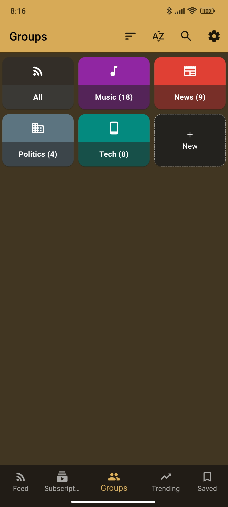
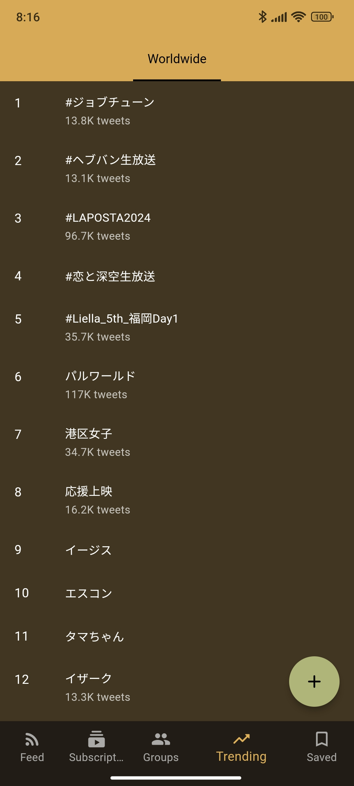

<h1 align="center"> Squawker </h1>
 

  

  <strong>Squawker</strong> is a free, open-source, privacy-focused client for X (formerly Twitter). It is forked from <a href="https://github.com/TheHCJ/Quacker">Quacker</a>
  and <a href="https://github.com/jonjomckay/fritter">Fritter</a>.

  
  
  
  
  

  
  

  To verify the downloaded APK from Github or Obtainium, use <a href=".github/certificate-fingerprints.txt">these signing certificate fingerprints</a>.

  

  The F-Droid repository deploys updates at an extremely slow pace: days, even weeks later. The recommended way is rather to get Squawker from Github or Obtenium.

  There is also an alternate F-Droid repository that allows updates for Squawker to be available faster than on the default F-Droid repository.

  Scan the QR code below or click this <a href="https://apkrep.creativaxion.org/fdroid/repo?fingerprint=443DA0A316DFB86BFD05D0123951855E7CD8724969FAD66D6E62EB801299744A">link</a> and process it with your F-Droid client. Here's the full link text for easy viewing: 
    https://apkrep.creativaxion.org/fdroid/repo?fingerprint=443DA0A316DFB86BFD05D0123951855E7CD8724969FAD66D6E62EB801299744A

  

 Important note: In case Squawker is already installed on your device and you want to reinstall it or want to install a version from another repository (from F-Droid to github or from F-Droid to the alternate F-Droid repository for instance), make sure to backup your application data (Settings/Data, tap Export, select all items then tap the save icon) and uninstall Squawker before proceeding.
  After you have reinstalled Squawker from the new repository, import your backup (Settings/Data, tap Import).

 
## Features:

* Privacy: No tracking, with all data local
* No ads: Not clogged by multiple ads
* Feed: View all your subscriptions in a chronological feed
* Subscriptions: Follow and group accounts
* Search: Find users and tweets
* Bookmarks: Save tweets locally and offline
* Trends: See what's trending in the world
* Polls: View results without needing to vote
* Light and Dark themes: Protect your eyes
* And more!
  
## Screenshots

| |  |  | 

## Contribute
If you'd like to help make Squawker even better, here are a just a few of the ways you can help!

### Report a bug
If you've found a bug in Squawker, open a [new issue](https://github.com/j-fbriere/squawker/issues/new/choose), but please make sure to check that someone else hasn't reported it first on Fritter or on Squawker.

### Fix a bug
If you're looking for something to dip your toes into the codebase, check if there are any issues labelled good first issue. Otherwise, if you see another issue you'd like to tackle, go for it - just fork the repository, push to a branch, and create a PR detailing your changes. We'll review it and merge it in, once it meets all our checks and balances!

### Translations
Most of Squawker's translations have come from [Weblate](https://hosted.weblate.org/engage/squawker/)

### Acknowledgments
Duck Icon: <a href="https://www.vecteezy.com/free-vector/bathroom">Bathroom Vectors by Vecteezy</a>
